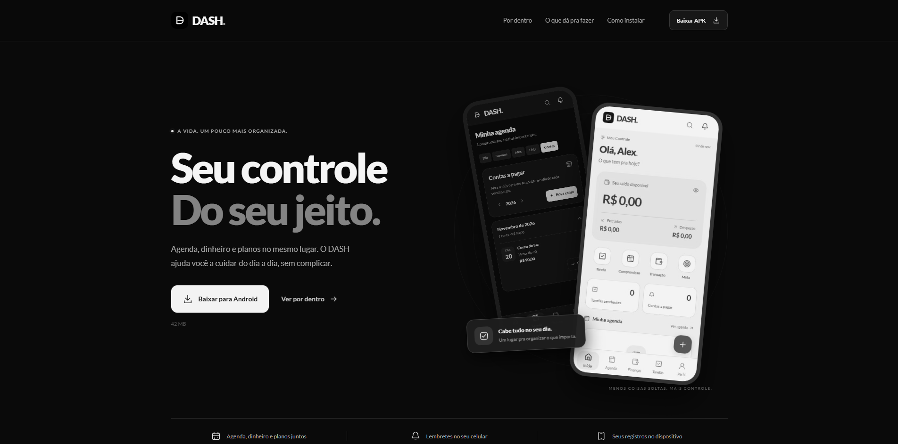

# 📱📊 ⎯ DASH 2.8.2

### Sua vida organizada. Tudo em um só lugar.

O **DASH** é um aplicativo de gerenciamento pessoal desenvolvido para proporcionar uma experiência moderna, intuitiva e completa na organização do dia a dia. Com uma interface minimalista em tons de preto, branco e cinza, a plataforma permite gerenciar compromissos, tarefas, finanças, contas a pagar, metas e eventos importantes, reunindo tudo em um único ambiente digital.
Disponível como projeto multiplataforma para **Android, Windows e Web**, futuramente para **iOS**, o DASH combina organização, praticidade e segurança em uma experiência personalizada.

## 📱 Demonstração
🔗 **Acesse o projeto online para Download:** https://shwnzzzz.github.io/Dash-ProjectShw/

## ✨ Funcionalidades
- 📊 Dashboard com visão geral da vida pessoal e financeira.
- 📅 Agenda interativa com calendário de compromissos.
- ✅ Gerenciamento de tarefas com prioridades e prazos.
- 💰 Controle financeiro de receitas e despesas.
- 💳 Organização de contas a pagar e pagamentos futuros.
- 🔄 Gerenciamento de contas recorrentes.
- 🎯 Acompanhamento de metas pessoais e financeiras.
- 📈 Gráficos financeiros e resumo anual.
- 🧾 Armazenamento local de comprovantes em PDF.
- 🔔 Notificações de tarefas, eventos e vencimentos.
- 🔐 Autenticação por e-mail e senha.
- 👆 Acesso por biometria, Face ID ou Touch ID em dispositivos compatíveis.
- 👤 Perfil personalizado com nome e foto.
- 🌙 Alternância entre Dark Mode e White Mode.
- 📱 Interface responsiva e adaptada para dispositivos móveis.
- 💾 Armazenamento local com separação dos dados por cadastro.
- ⚡ Navegação intuitiva e gerenciamento simplificado.

## 🆕 Novidades da versão 2.8.2
A versão **2.8.2** apresenta melhorias de autenticação, organização financeira, notificações e experiência do usuário.

- 🔐 Validação de acesso por e-mail e senha correspondentes.
- 👆 Autorização individual para autenticação biométrica.
- 📱 Tela de desbloqueio ao reabrir o aplicativo.
- 📅 Organização das contas por mês e ano de vencimento.
- 💳 Registro de pagamentos e gerenciamento de cobranças recorrentes.
- 🔄 Geração automática da próxima cobrança após o pagamento.
- 🧾 Preservação de comprovantes e históricos financeiros.
- 🔔 Configuração personalizada de lembretes e notificações.
- 👤 Melhorias no gerenciamento da foto de perfil.
- 💾 Preservação dos dados locais durante atualizações compatíveis.
- 🎨 Aprimoramentos visuais e de usabilidade.

## 🎨 Identidade Visual
O DASH utiliza uma identidade visual moderna, sofisticada e minimalista, inspirada em dashboards de produtividade e plataformas de gerenciamento pessoal.

- **Cores predominantes:** Preto, branco e cinza.
- **Dark Mode:** Interface escura com elementos de alto contraste.
- **White Mode:** Interface clara e suave, com controles em azul.
- **Indicadores financeiros:** Verde para entradas e tomato para despesas.
- **Tipografia:** Lato.
- **Estilo:** Minimalista, moderno e funcional.
- **Design:** Interface mobile em coluna única, com componentes organizados.
- **Experiência:** Navegação intuitiva, segura e personalizada.

## 🔐 Segurança e Privacidade
O DASH prioriza a privacidade do usuário por meio do armazenamento local das informações e da autenticação individual de cada cadastro.

- 🔒 Verificação de senhas com PBKDF2-HMAC-SHA256.
- 🛡️ Salt aleatório e 600.000 iterações na derivação de senhas.
- 👆 Autenticação biométrica utilizando os recursos nativos do dispositivo.
- 📂 Separação dos registros entre diferentes cadastros locais.
- 💾 Armazenamento das informações no próprio dispositivo.
- ☁️ Sem sincronização automática com serviços em nuvem.
- 🔑 Autorização biométrica protegida pelos mecanismos do sistema operacional.

**Observação:** Os registros locais não são criptografados em disco. A exclusão dos dados do aplicativo ou navegador pode remover permanentemente as informações armazenadas. O cadastro não possui verificação de e-mail nem recuperação de senha por e-mail.

## 🔔 Notificações Inteligentes
O aplicativo oferece um sistema de lembretes configuráveis para ajudar o usuário a acompanhar suas responsabilidades.

- ✅ Tarefas: lembrete padrão de 15 minutos.
- 💳 Contas: lembrete padrão de um dia.
- 📅 Eventos: lembrete padrão de 30 minutos.
- ⏰ Personalização de horários e antecedência.
- 🔄 Atualização automática dos agendamentos após alterações.
- 📱 Notificações locais em Android e iOS.
- 🔔 Central interna de avisos nas versões Web e Windows.

O sistema mantém até **60 notificações futuras** agendadas localmente, renovando a fila durante a utilização do aplicativo.

## 📲 Plataformas e Instalação

### 🤖 Android
- Arquivo: `DASH-2.8.2-Android.apk`
- Compatibilidade: Android 7 ou superior.
- Arquitetura: dispositivos de 64 bits.
- Autenticação biométrica em aparelhos compatíveis.
- Notificações locais e gerenciamento de lembretes.

## 🛠️ Tecnologias utilizadas
- React Native
- Expo SDK 55
- TypeScript
- JavaScript
- Electron
- Node.js
- pnpm
- HTML5
- CSS3
- PBKDF2-HMAC-SHA256
- APIs nativas de biometria
- Armazenamento local
- Sistema de notificações locais

## 🧪 Testes e Qualidade
O DASH conta com **55 testes automatizados**, abrangendo funcionalidades essenciais para garantir a confiabilidade do aplicativo.
Entre os recursos testados estão:

- Autenticação por e-mail e senha.
- Autorização biométrica individual.
- Isolamento de dados entre cadastros.
- Cálculos e registros financeiros.
- Contas recorrentes e vencimentos.
- Organização de pagamentos.
- Preservação de comprovantes.
- Gerenciamento de tarefas e eventos.
- Datas, fusos horários e recorrências.
- Configurações de notificações.
- Preservação de informações durante atualizações.
- Inicialização de novos cadastros.

## 🎯 Objetivo do projeto
O DASH foi desenvolvido como um projeto de aplicativo multiplataforma, com o objetivo de aplicar conhecimentos de desenvolvimento de software, programação, gerenciamento de dados, autenticação, interfaces interativas e princípios de UI/UX Design. O projeto busca demonstrar como a tecnologia pode simplificar a organização pessoal, permitindo que usuários gerenciem suas atividades, compromissos e finanças de maneira prática, centralizada e eficiente. Além disso, o DASH representa a aplicação de conceitos de desenvolvimento mobile e desktop, integração com recursos nativos dos dispositivos, segurança de autenticação e construção de experiências digitais modernas e funcionais.

## 👨‍💻 Desenvolvedor

**ShwDevs** Desenvolvimento de Software | UI/UX Design | Desenvolvimento Mobile

---

  Desenvolvido com 🖤 por <strong>ShwDevs</strong>
   
  <strong>DASH — Sua rotina, suas metas, seu controle.</strong>
   
  <strong>Versão 2.8.2</strong>

